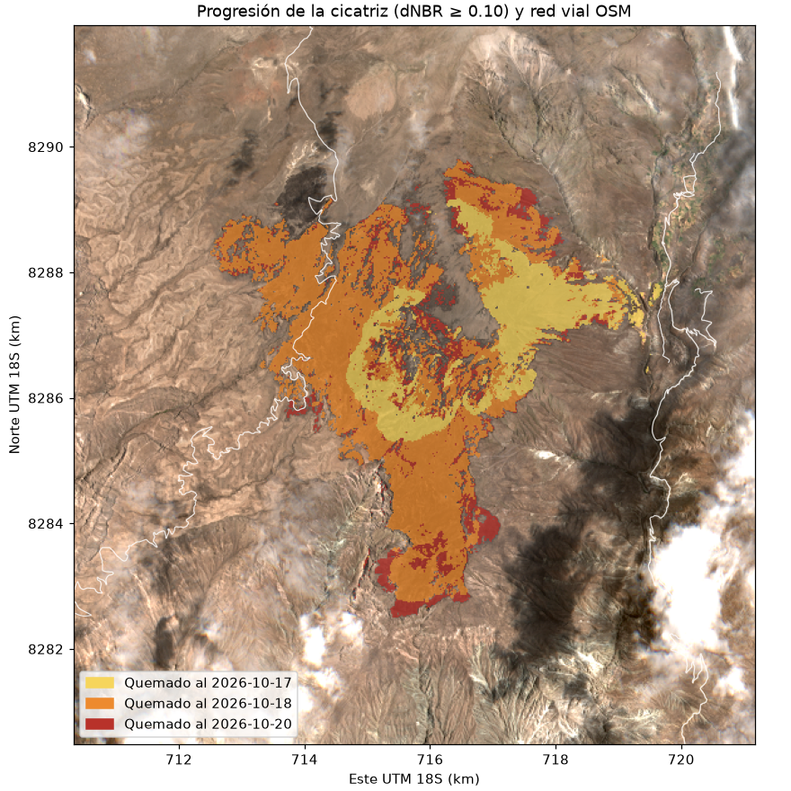
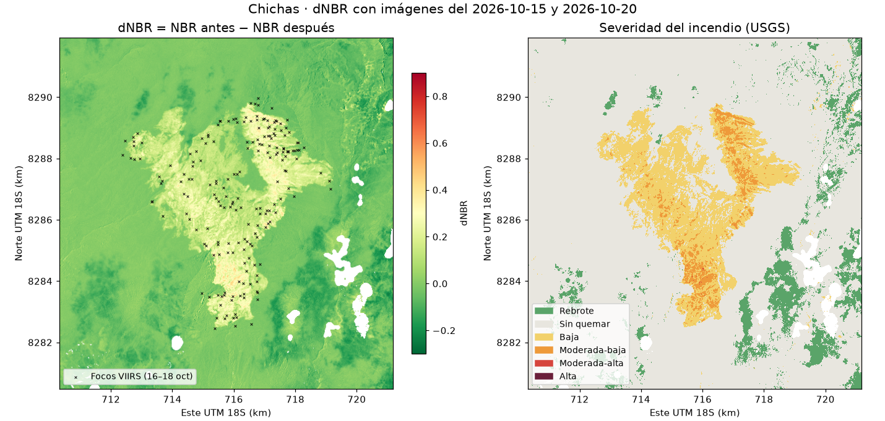
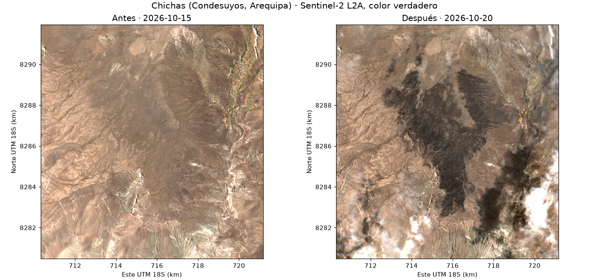

# PRÁCTICA 1 · ¿Cuánto se quemó en Chichas?

**Reto A · Otro incendio.** Tarea práctica de raster, Ciencia de Datos con Python (Python Intermedio), 21 de octubre de 2026.

- **Estudiante:** Cristian Moises Wong Pagan ([@Cris92W](https://github.com/Cris92W))
- **Dashboard web:** https://claude.ai/artifact/GrgeJNJdqtggyNVSFus5bd
- **Notebook:** [`PRACTICA_1.ipynb`](PRACTICA_1.ipynb)
- **Repositorio:** https://github.com/Cris92W/Python-Intermedio/tree/main/PRACTICA_1

## Pregunta

¿Cuántas hectáreas quemó el incendio de **Chichas (Condesuyos, Arequipa)** entre el 16 y el 18 de octubre de 2026, cómo avanzó y qué tan cerca estuvo de poblados y vías?

## Datos y fechas

| Dato | Fuente | Fecha |
|---|---|---|
| Focos de calor VIIRS 375 m (S-NPP, NOAA-20, NOAA-21) | NASA FIRMS, CSV «South America 7d» | 14 al 21 oct 2026 |
| Sentinel-2 L2A (tesela 18LYH) | Microsoft Planetary Computer | Antes: 15 oct (0 % nubes en la zona). Después: 20 oct (1,9 %). Progresión: 17 y 18 oct |
| Copernicus DEM GLO-30 | Microsoft Planetary Computer | — |
| Poblados y vías | OpenStreetMap (API de OSM) | Descarga del 21 oct 2026 |
| Límites distritales | INEI, `juaneladio/peru-geojson` | — |

## Método

1. Focos FIRMS de 7 días, cruzados con los distritos del Perú (`shapely`).
2. Agrupamiento DBSCAN: focos a ≤ 1 km forman un incendio (mínimo 3 focos). Chichas es el 3.º más grande de la semana.
3. Búsqueda STAC de Sentinel-2 y lectura de solo la ventana del incendio desde COG (`rasterio`).
4. % de nubes medido con la capa SCL dentro de la zona, no en toda la tesela.
5. NBR = (B8A − B12) / (B8A + B12) a 20 m; dNBR = NBR antes − NBR después, con máscara SCL.
6. Severidad con umbrales USGS y hectáreas (píxel de 20 m = 0,04 ha), por distrito.
7. Progresión con las imágenes del 17, 18 y 20 oct; relieve y pendiente con el DEM; distancia a poblados y vías de OSM con un árbol KD.

## Tres hallazgos

1. **Creció en dos días y se detuvo.** La cicatriz pasó de **433 ha** (17 oct) a **1 439 ha** (18 oct) y **1 647 ha** (20 oct). VIIRS detectó 6, 110 y 82 focos el 16, 17 y 18 de octubre, y ninguno después.
2. **El umbral cambia el número.** **1 647 ha** con dNBR ≥ 0,10 frente a **242 ha** con el umbral clásico de 0,27 (6,8 veces más). La cicatriz visible coincide con la primera cifra: es pajonal de puna y la mediana del dNBR dentro de la cicatriz es solo 0,18. Casi todo es de severidad baja; el 68 % está en Chichas y el 32 % en Toro (La Unión).
3. **Llegó casi a los poblados.** El caserío **Quichuana** queda a **0,1 km** del área quemada y el pueblo **Cahuanota** a 0,15 km; hay 16,8 km de vías a ≤ 1 km. El fuego quemó puna entre **3 287 y 4 091 m s. n. m.** (pendiente media de 20°).

## Mapas







## Limitaciones

- **Un foco de calor no es un incendio:** agrupar a ≤ 1 km es una decisión de método.
- **Las nubes esconden el fuego:** la imagen del 20 oct tiene nubes al sureste (enmascaradas) y algunas sombras escapan a la SCL; las imágenes del 17 y 18 oct tienen humo del fuego activo.
- **El umbral cambia el resultado casi 7 veces** y no hay calibración oficial del dNBR para pajonal andino.
- **OpenStreetMap está incompleto** en la sierra rural (casi sin edificaciones dibujadas).
- Los focos FIRMS de 7 días son preliminares (NRT). Este trabajo no reemplaza los reportes del COEN, INDECI, SERFOR ni SERNANP.

## Cómo ejecutarlo

```bash
pip install pandas numpy matplotlib scipy scikit-learn shapely rasterio pystac-client planetary-computer requests pillow jupyter
jupyter nbconvert --to notebook --execute PRACTICA_1.ipynb
```

Corre en CPU en unos 5 minutos y no necesita claves. Los datos descargados quedan en `datos/` y se reutilizan. La página web es `incendio_chichas.html`.
