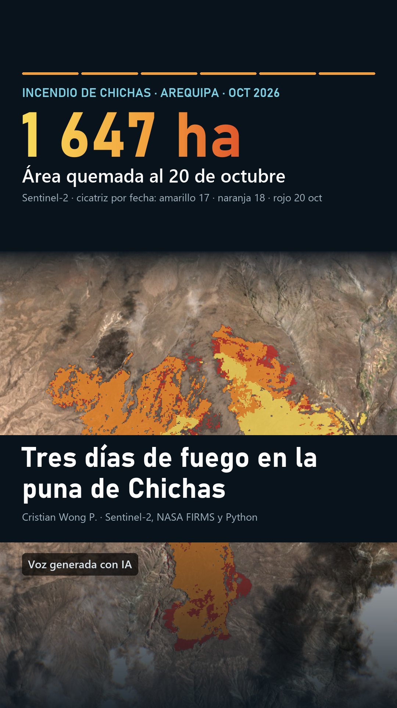

# PRÁCTICA 2 · Del texto a tu voz: el incendio de Chichas en 49 segundos

**Sesión 15 · Reels con modelos abiertos.** Ciencia de Datos con Python (Python Intermedio), 24 de octubre de 2026.

- **Estudiante:** Cristian Moises Wong Pagan ([@Cris92W](https://github.com/Cris92W))
- **Video para ver y compartir:** https://claude.ai/artifact/K2cegSi4CJLBcXJy3H9Wuh
- **Video:** [`reel.mp4`](reel.mp4) · subtítulos [`reel.srt`](reel.srt) · portada [`portada.png`](portada.png)
- **Texto de origen:** el informe de la [PRÁCTICA 1](../PRACTICA_1/) ([versión web](https://claude.ai/artifact/GrgeJNJdqtggyNVSFus5bd))

<a href="reel.mp4"></a>

## La tarea

Convertir un texto largo de la carrera en un reel de 30 a 60 segundos narrado con la propia voz, usando solo modelos abiertos, y revisar el guion contra la fuente antes de publicarlo.

## El flujo

| Paso | Qué se hizo | Herramienta | Archivos |
|---|---|---|---|
| 1. Texto largo | Informe de teledetección del incendio de Chichas (PRÁCTICA 1) | — | [`informe_chichas.txt`](informe_chichas.txt) |
| 2. Guion | Seis escenas a partir de los datos clave del informe | Qwen3.8 en chat.qwen.ai | [`prompt_qwen.txt`](prompt_qwen.txt) → [`guion_qwen_original.txt`](guion_qwen_original.txt) |
| 3. Revisión | Lectura del guion contra el informe, frase por frase | Yo | [`revision.md`](revision.md) → [`guion.json`](guion.json) |
| 4. Voz | Clonación de mi voz a partir de 17 s de audio; Whisper vuelve a escuchar cada escena y la rehace si entiende mal más del 25 % de las palabras | Qwen3-TTS `Qwen3-TTS-12Hz-0.6B-Base` (local, CPU) + faster-whisper `small` | [`voz.py`](voz.py) |
| 5. Video | Subtítulos palabra por palabra, mapas animados y audio a volumen de redes | faster-whisper + Pillow + ffmpeg (`imageio-ffmpeg`) | [`video.py`](video.py) → `reel.mp4`, `reel.srt`, `portada.png` |

## Qué corregí del guion

Qwen acertó todas las cifras, pero dos frases decían algo que el informe no dice (detalle en [`revision.md`](revision.md)):

- **«Detecté el primer foco».** Lo detectó el satélite NOAA-20; yo analicé los datos después. Quedó «un satélite detecta el primer foco».
- **«El área se triplicó: mil seiscientas cuarenta y siete hectáreas».** Mezclaba dos datos: se triplicó del 17 al 18 (433 → 1 439 ha) y llegó a 1 647 ha el 20. Quedó «al día siguiente, el área se triplicó; para el veinte sumaba…».

En el primer intento, Qwen no escribió el guion: comentó el análisis y agregó afirmaciones sin respaldo («pastoreo de camélidos», «impacto profundo y de muy lenta recuperación», «riesgo social inminente»). Las cifras se verifican con código; las afirmaciones las verifica una persona.

## Resultado

| | |
|---|---|
| Duración | 49,0 s (seis escenas) |
| Formato | 1080 × 1920, 30 fps, H.264 + AAC, 6,4 MB |
| Volumen | −14,3 LUFS integrado, picos a −1 dB |
| Control de la voz | Las seis escenas pasaron al primer intento: Whisper entendió mal entre 0 % y 13 % de las palabras |
| Tiempo de cálculo en CPU | Voz: 13 min (unos 2 min por escena) · video: 1,5 min |

Las animaciones se disparan con el tiempo de cada palabra que midió Whisper: los primeros seis focos aparecen al decir «detecta», los 198 focos salen en orden de hora mientras el contador sube, la cicatriz se colorea por fecha al decir «diecisiete», «siguiente» y «veinte» (433 → 1 439 → 1 647 ha), y Quichuana y Cahuanota se encienden cuando se nombran. Los subtítulos muestran el texto del guion, no lo que Whisper creyó oír.

## Ética y avisos

- **Solo mi voz.** La muestra de voz (`mi_voz.*`) no se sube al repositorio.
- **IA declarada.** «Voz generada con IA» se ve durante todo el video.
- **Revisión antes de narrar.** El guion completo se revisó contra el informe antes de generar el audio.
- **No es un reporte oficial.** Las cifras no reemplazan los reportes del COEN, INDECI, SERFOR ni SERNANP.

## Limitaciones

- En la escena 6, Whisper transcribió «FIRMS» como «fierremes» y en la 5, «Cahuanota» como «Cajuanota»: la voz sintética no pronuncia bien siglas ni algunos nombres quechuas.
- `video.py` usa las imágenes y los datos de `../PRACTICA_1/salidas/web/`, así que depende de esa carpeta.

## Archivos

| Archivo | Contenido |
|---|---|
| `reel.mp4`, `reel.srt`, `portada.png` | El video, sus subtítulos y la portada |
| `prompt_qwen.txt` | Lo que se pegó en Qwen3.8 |
| `guion_qwen_original.txt` | El guion tal como lo escribió Qwen |
| `revision.md` | Qué se corrigió y por qué |
| `guion.json` | Guion revisado: frase, cifra en pantalla, capas, cámara y momentos de cada animación |
| `informe_chichas.txt` | Texto del informe, usado para revisar el guion |
| `voz.py` | Paso 4: voz con Qwen3-TTS y control con Whisper |
| `video.py` | Paso 5: cuadros con Pillow y video con ffmpeg |
| `requirements.txt` | Versiones de los paquetes |

## Cómo reproducirlo (Windows, solo CPU)

```bash
cd PRACTICA_2
uv venv --python 3.12 .venv
uv pip install --python .venv\Scripts\python.exe -r requirements.txt
.venv\Scripts\python -c "from huggingface_hub import snapshot_download; snapshot_download('Qwen/Qwen3-TTS-12Hz-0.6B-Base', local_dir='modelos/Qwen3-TTS-12Hz-0.6B-Base')"
# Graba unos 15 s de tu voz como mi_voz.ogg (o .mp3, .m4a); si quieres, escribe en mi_voz.txt lo que dices
.venv\Scripts\python voz.py     # unos 13 min
.venv\Scripts\python video.py   # unos 1,5 min
```

- El modelo se descarga con `local_dir` porque la caché de Hugging Face usa enlaces simbólicos que Windows no permite sin el modo de desarrollador.
- Con faster-whisper 1.2.1 y el PyAV que instala `qwen-tts`, Whisper no lee mp3 ni ogg directamente; `voz.py` convierte la muestra a WAV con el ffmpeg de `imageio-ffmpeg`.
- `voz.py` no repite una escena ya generada con la misma frase y la misma muestra de voz; para rehacerla, borra `salidas/escena_NN.*`.

## Fuentes y modelos

- Qwen3.8 y Qwen3-TTS (Alibaba Qwen, Apache 2.0) · faster-whisper (SYSTRAN, MIT) sobre Whisper `small` (OpenAI).
- Focos de calor: NASA FIRMS, VIIRS 375 m · Imágenes: ESA Copernicus Sentinel-2 L2A · Poblados: © colaboradores de OpenStreetMap (ODbL).
- Flujo y requisitos del video: diapositivas de la sesión 15, «Del texto a tu voz: reels con modelos abiertos».
