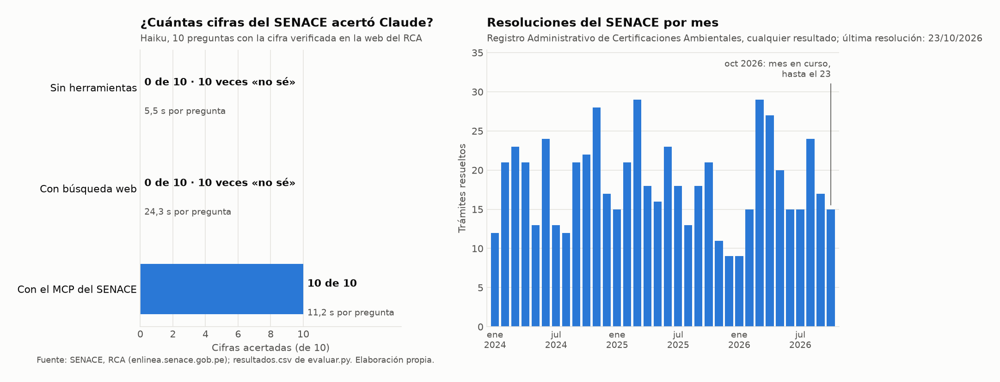

# Informe · ¿Le sirve a Claude un MCP del SENACE?

**Evaluación del 28 de octubre de 2026.** Diez preguntas con cifra oficial del Registro Administrativo de
Certificaciones Ambientales (RCA) del SENACE, hechas al modelo Haiku con `claude -p` en tres modos: sin herramientas
(memoria), con búsqueda web y con el MCP del SENACE. Datos del RCA al 28/10/2026, con la última resolución del
23/10/2026.

## Resultados

| Modo | Acierta | Se equivoca | «No sé» | Segundos por pregunta | Turnos por pregunta |
|---|:---:|:---:|:---:|:---:|:---:|
| Sin herramientas (memoria) | 0 | 0 | 10 | 5,5 | 2,0 |
| Con búsqueda web | 0 | 0 | 10 | 24,3 | 5,1 |
| **Con el MCP del SENACE** | **10** | **0** | **0** | **11,2** | 3,2 |

Fuente: [`resultados.csv`](resultados.csv), el experimento extra con los tres modos. La corrida base, solo memoria y
MCP ([`resultados_base.csv`](resultados_base.csv)), dio lo mismo: 0 de 10 sin herramientas (6,3 s) y 10 de 10 con el MCP
(13,2 s).



## Qué falló cada modo y por qué

**Sin herramientas.** Haiku no conoce trámites de 2025 y 2026, y como la instrucción le permitía responder `null`,
dijo «no sé» en las diez preguntas. No inventó ninguna cifra.

**Con búsqueda web.** También 0 de 10, y cuatro veces más lento que sin herramientas. La columna `fuente` muestra que
sí encontró información del SENACE, pero nunca la cifra pedida:

- Notas de prensa y boletines con **otros cortes**: «69 expedientes aprobados de enero a la primera semana de mayo de
  2026», «52 expedientes mineros certificados entre enero y setiembre de 2026». No sirven para un mes o un
  trimestre concreto.
- La resolución del ITS de Quellaveco (R.D. N° 00134-2026, del 27/08/2026), pero **no su fecha de ingreso**, así que no
  pudo calcular los días de evaluación.
- Para los trámites de Iscaycruz y Las Bambas, nada: ninguna página indexada menciona esos expedientes.

La razón es que el RCA es un **formulario de búsqueda**. Sus resultados se generan cuando alguien filtra y pulsa
«Buscar», así que no existen como páginas que un buscador pueda encontrar.

**Con el MCP.** 10 de 10, en unos 3 turnos: elige la herramienta (`resumen` para los conteos, `certificacion` y
`buscar_certificaciones` para los trámites, `plazos` para la mediana) y cita el trámite o la resolución y la fecha de
corte. En 9 de las 10 respuestas la fuente nombra el RCA o su enlace.

## Dos cifras comprobadas a mano en la web del RCA

Las dos son preguntas propias. Se buscan en https://enlinea.senace.gob.pe/Certificacion/CatalagoCertificacion
llenando un solo campo y pulsando **Buscar**:

| Pregunta | Búsqueda en la web | Lo que muestra la página | Verdad | MCP |
|---|---|---|:---:|:---:|
| Días de evaluación del trámite 03951-2025 (segunda actualización del EIA de Iscaycruz-Lagsaura) | NRO. TRÁMITE = `03951-2025` | Fecha de ingreso 19/09/2025; fecha de resolución 23/10/2026 | 399 | 399 |
| Número de la R.D. que aprobó en setiembre de 2026 el segundo ITS de la cuarta MEIA-d de Las Bambas | TITULAR = `LAS BAMBAS` | Trámite M-ITS-00100-2026, R.D. N° 00145-2026-SENACE-PE/DEAR, del 11/09/2026 | 145 | 145 |

La verdad de las diez preguntas se comprobó además con [`verificar_web.py`](verificar_web.py), que hace las mismas
búsquedas de la página (por trámite, titular, resultado, tipo, sector o departamento) sin usar el código del
servidor.

## El RCA frente a las cifras publicadas

| Publicación | Lo que dice | El RCA |
|---|---|---|
| SENACE, comunicado replicado por [ProActivo](https://proactivo.com.pe/en-un-ano-senace-aprobo-18-eia-d-y-meia-d-por-us-10700-millones-para-reactivar-la-economia/) | 18 aprobados en 2025: 5 EIA-d y 13 MEIA-d | 5 EIA-d y 13 MEIA-d con resultado «aprobado» en 2025: **coincide** |
| [Energiminas, 19/05/2026](https://energiminas.com/2026/05/19/en-lo-que-va-del-ano-senace-ya-aprobo-expedientes-por-mas-de-us-9-500-millones/) | 202 expedientes aprobados en 2025 | 131 «aprobado» y 70 «conforme» = **201**: para la prensa, «aprobados» incluye las conformidades de los ITS |

## Lo que se aprendió de los datos del SENACE

- **El portal de datos abiertos está congelado.** [datosabiertos.senace.gob.pe](https://datosabiertos.senace.gob.pe)
  no tiene registros posteriores al 07/05/2024. El RCA, en cambio, crece cada mes: por eso el servidor usa el RCA.
- **El filtro de departamento de la web no filtra.** Al pedir Piura, la página devuelve los 171 trámites resueltos
  entre enero y setiembre de 2026 en todo el país; solo 20 tienen Piura en su ubicación. El MCP responde 20, porque
  lee la ubicación de cada trámite.
- **Hay fechas imposibles.** 15 de los 2 304 trámites tienen la fecha de ingreso posterior a la de resolución; por
  ejemplo, RS-TDR-00161-2026 ingresó el 31/12/2026 y se resolvió el 23/10/2026. La herramienta `plazos` los excluye y
  los cuenta aparte.
- **«Aprobado» no es lo único favorable.** Un ITS o un plan de participación ciudadana puede salir «conforme», y es
  igual de favorable. Contar solo «aprobado» subestima lo que la prensa llama aprobaciones.
- **Los plazos son días calendario.** El SENACE informa sus plazos en días hábiles, que son menos.

## Conclusión

Un MCP vale la pena cuando el dato oficial existe pero está detrás de un formulario o una base que los buscadores no
indexan, como el RCA. Ahí ni la memoria ni la búsqueda web llegan a la cifra, y el MCP acertó las diez, en la mitad
del tiempo que la web y con el número de trámite que permite verificar cada respuesta. La búsqueda web basta para
lo que la institución publica en notas y boletines, pero esas cifras vienen con sus propios cortes y definiciones,
como «aprobados» con o sin conformidades.

## Limitaciones

- Diez preguntas, un modelo (Haiku) y una corrida por modo.
- Las preguntas, con sus respuestas, están en este repositorio público; en el futuro, el modo web podría
  encontrarlas. Los resultados valen para la fecha de esta evaluación.
- El SENACE puede corregir registros del RCA; las cifras son al 28/10/2026.
- Para que el modo memoria no leyera notas del proyecto, `evaluar.py` lanza a Claude sin su memoria automática y desde
  una carpeta temporal fuera del repositorio. Sin esos dos cambios, una primera corrida mostró que Claude veía las
  notas y el estado de git del proyecto, aunque igual respondió «no sé».

## Cómo reproducirlo

```bash
uv run pytest -q                              # 9 pruebas del servidor
uv run verificar_web.py                       # la verdad de cada pregunta, desde la web del RCA
uv run evaluar.py                             # corrida base: memoria y MCP
cp resultados.csv resultados_base.csv
uv run evaluar.py --modos memoria web mcp     # experimento extra: también con búsqueda web
uv run grafico.py                             # grafico.png
```
