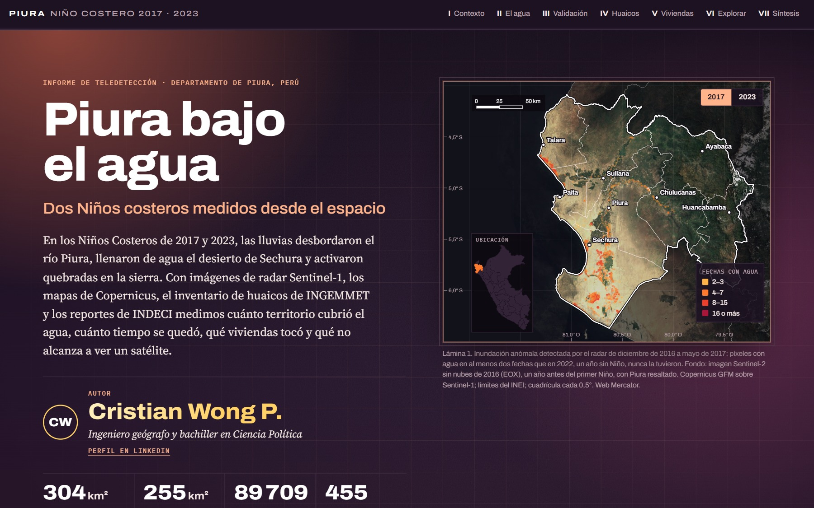
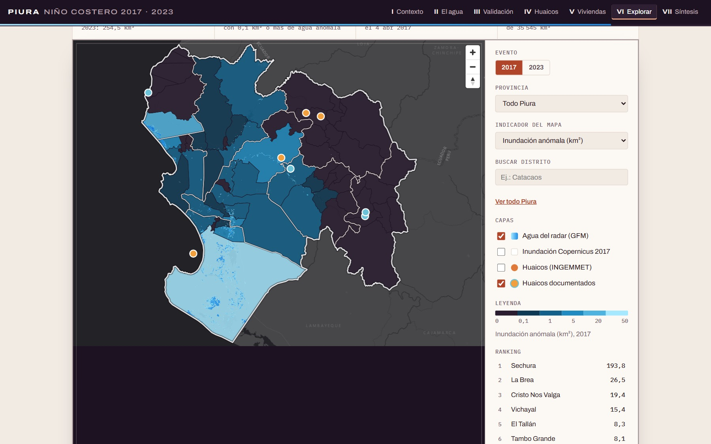

# Tarea 3 – Piura bajo el agua: dos Niños costeros medidos desde el espacio (2017 y 2023)

- **Autor:** Cristian Wong P., ingeniero geógrafo y bachiller en Ciencia Política · [LinkedIn](https://www.linkedin.com/in/cristian-wong-pagan-09a04613b/)
- **Dashboard:** https://cris92w.github.io/Python-Intermedio/tarea_3/web/
- **Reel (60 s):** [`reel/reel.mp4`](reel/reel.mp4), con su guion, scripts y créditos en [`reel/`](reel/)
- **Publicación de LinkedIn:** [Piura bajo el agua](https://www.linkedin.com/posts/cristian-wong-pagan-09a04613b_cienciadedatos-python-teledetecciaejn-ugcPost-7521129565516161025-YwRA/)

## 1. Tema y pregunta de investigación

Inundaciones y huaicos de los Niños Costeros de 2017 y 2023 en el departamento de Piura.

> ¿Cuánto territorio cubrió el agua en Piura en los Niños Costeros de 2017 y 2023, cuánto tiempo se quedó,
> qué viviendas tocó, dónde hubo huaicos, y qué detectan —y qué omiten— las imágenes satelitales frente a los
> registros oficiales?

- **Cobertura geográfica:** departamento de Piura, 8 provincias y 65 distritos (35 546 km²).
- **Cobertura temporal:** 2017 = diciembre 2016 a mayo 2017; 2023 = enero a junio 2023 (incluye el ciclón Yaku;
  se amplió desde abril porque el agua seguía creciendo al cierre, y así coincide con los datos de INDECI 2023).
  Año de referencia sin Niño: enero a junio 2022.

## 2. Descripción

Se midió la superficie con agua por distrito con radar satelital (Sentinel-1, procesado por Copernicus GFM),
descontando el agua habitual de un año sin Niño. Se validó contra la delimitación manual de Copernicus EMS de
2017, se cruzó con los daños oficiales de INDECI, se ubicaron en 3D los edificios de la ciudad de Piura y el Bajo
Piura que quedaron en zonas afectadas, y se documentaron los huaicos con el inventario de INGEMMET y eventos de
2017 y 2023. El resultado es un story map por capítulos con un explorador por distrito.

## 3. Fuentes de datos (consultadas entre el 26 y el 27/10/2026)

| Fuente | Qué se usó | Acceso |
|---|---|---|
| Copernicus Global Flood Monitoring (GFM) | 945 escenas de inundación (20 m) sobre Piura: 309 de 2017, 388 de 2023 y 248 de 2022 | Catálogo STAC abierto de EODC: https://stac.eodc.eu/api/v1 (colección `GFM`) |
| Copernicus EMS, activación EMSR199 | Delimitación de la inundación y grado de daño por manzana en 8 áreas de Piura (marzo–abril 2017) | https://mapping.emergency.copernicus.eu/activations/EMSR199/ |
| INGEMMET, GEOCATMIN | 487 puntos de flujos en Piura, 455 de ellos flujos de detritos o de lodo (huaicos); informes técnicos A7091 y A7093 | https://geocatmin.ingemmet.gob.pe/arcgis/rest/services/SERV_PELIGROS_GEOLOGICOS/MapServer |
| INDECI, Compendio Estadístico 2017 | Daños del Niño Costero en Piura (pp. 13–15, corte al 04/07/2017) y relato de eventos | https://cdn.www.gob.pe/uploads/document/file/1048401/20180227171454120200726-15599-1ptpifw.pdf |
| INDECI, Compendio Estadístico 2023 | Daños del primer semestre 2023 en Piura (pp. 233–237) | https://cdn.www.gob.pe/uploads/document/file/5591372/4965310-compendio-final-af-2023-indeci.pdf |
| Prensa (Andina, El Tiempo, Trome, Panamericana) | Fecha y efectos de huaicos puntuales de 2023, enlazados en `datos/procesados/huaicos_eventos.csv` | Enlaces en el cuadro 4 del dashboard |
| Microsoft Global ML Building Footprints | 126 082 edificios de la ciudad de Piura y el Bajo Piura, licencia ODbL | https://github.com/microsoft/GlobalMLBuildingFootprints |
| INEI, límite distrital 2020 | Distritos y provincias de Piura (vía el dataset del curso en Hugging Face) | `aquiro1994/ds-python-up`, `_data/LIMITE_DISTRITAL_2020_INEI.zip` |

## 4. Metodología

1. **Agua con radar.** GFM marca en cada imagen Sentinel-1 el agua que no es habitual para ese mes. Se leyeron
   las escenas directamente del catálogo (archivos COG, vista de 80 m) y se contaron los píxeles con agua por
   distrito. Para no contar dos veces, las escenas de una misma fecha y tile se combinan antes de contar.
2. **Agua habitual.** La máscara de agua habitual de GFM se armó con datos de 2017 a 2021, así que no basta para esta
   costa. Se procesó igual enero–junio de 2022, un año sin Niño. La **inundación anómala** solo cuenta los píxeles con
   agua en al menos dos fechas del evento que en 2022 nunca tuvieron agua.
3. **Corrección de área.** La proyección de GFM (Equi7) agranda las áreas un 2 % en Piura; se corrige.
4. **Validación.** Por cada área mapeada por Copernicus EMS en 2017 se mide qué porcentaje de su inundación también
   detectó el radar.
5. **Huaicos.** El radar no los ve, así que se usan el inventario de campo de INGEMMET (dónde bajan) y nueve eventos
   de 2017 y 2023 compilados de INDECI, INGEMMET y prensa (cuándo bajaron), cada uno con su fuente. También se mide
   cuántos puntos de huaico tienen agua del radar a menos de 160 m.
6. **Edificios.** Un edificio cuenta como afectado si su centro cae en una zona inundada de Copernicus, en una
   manzana con daño o en el agua del radar.
7. **Daños oficiales.** Las cifras de INDECI se transcribieron de los compendios y se verificaron contra la imagen de
   cada tabla.

## 5. Tres hallazgos

1. **El agua se quedó en el desierto de Sechura, por semanas.** La provincia de Sechura concentró el 72 % del agua anómala de 2017 (218 de 304 km²) y el 74 % de la de 2023 (188 de 255 km²). El agua no se fue con la lluvia: el día con más agua de 2017 fue el 4 de abril (240 km²), una semana después del desborde del río Piura, y el de 2023 llegó recién el 9 de mayo (228 km²), dos meses después del ciclón Yaku; el 26 de junio de 2023 aún quedaban 165 km².
2. **El radar no ve dónde vive la gente, ni los huaicos.** Frente a la delimitación manual de Copernicus de 2017, el radar detectó el 46 % de la inundación del Bajo Piura, entre 10 y 13 % en Sechura, y 8 % y 0 % en los dos sectores mapeados de la ciudad de Piura. De 1 322 edificios en zonas inundadas o manzanas dañadas, marcó 14. Y ninguno de los 455 puntos de huaico de INGEMMET tuvo agua del radar cerca: los huaicos de Canchaque o Paimas solo se conocen por INDECI, INGEMMET y la prensa.
3. **En 2023 hubo casi tanta agua, pero lejos de la ciudad.** El agua anómala de 2023 fue el 84 % de la de 2017, y los afectados según INDECI, el 80 %. Pero los damnificados bajaron al 33 % (29 493 frente a 89 709) y las viviendas destruidas al 11 % (2 443 frente a 21 412). La diferencia está en dónde cayó el agua: en la provincia de Piura, donde está la ciudad, el radar vio 9 km² en 2023 frente a 28 km² en 2017; el resto se quedó en el desierto de Sechura y en las quebradas de Talara y Paita.

## 6. Limitaciones

- El radar subestima la inundación urbana (el pulso rebota en las paredes) y no ve los huaicos ni las crecidas de horas.
- Solo ve lo que estaba inundado al pasar (cada 3 a 5 días); cada pasada cubre una parte del territorio.
- Arena seca, salinas y arrozales pueden parecer agua; la referencia de 2022 descuenta lo habitual, pero es un solo
  año, y en enero y febrero de 2022 el radar pasó pocas veces.
- Los nueve huaicos documentados son una muestra, no un censo; el inventario de INGEMMET es mayormente anterior a 2011.
- INDECI 2023 incluye todas las emergencias del primer semestre; el informe de 2017 es específico del Niño Costero.
- Los edificios de Microsoft vienen de imágenes de varios años: en 2017 algunas casas aún no existían. La altura
  en el 3D es ilustrativa.

## 7. Enlaces

- **Dashboard público:** https://cris92w.github.io/Python-Intermedio/tarea_3/web/
- **Publicación de LinkedIn** (reel, capturas del dashboard y hallazgos): https://www.linkedin.com/posts/cristian-wong-pagan-09a04613b_cienciadedatos-python-teledetecciaejn-ugcPost-7521129565516161025-YwRA/
- **Reel:** [`reel/reel.mp4`](reel/reel.mp4); guion, scripts y créditos en [`reel/`](reel/)
- **Repositorio:** https://github.com/Cris92W/Python-Intermedio/tree/main/tarea_3

| Portada: el agua que vio el radar en 2017 | Explorador por distrito |
|---|---|
|  |  |

Las tres capturas de escritorio del dashboard están en [`capturas/`](capturas/).

## 8. Cómo reproducirlo

Requiere Python 3.12 y [uv](https://docs.astral.sh/uv/). Desde `tarea_3/`:

```bash
uv venv .venv --python 3.12
uv pip install --python .venv/Scripts/python.exe -r requirements.txt   # en Linux/Mac: .venv/bin/python

.venv/Scripts/python.exe scripts/obtener_limites.py      # límites INEI de Piura (simplificados como cobertura: calzan entre niveles) y contorno del Perú
.venv/Scripts/python.exe scripts/inventario_gfm.py       # escenas GFM de 2017, 2023 y 2022
.venv/Scripts/python.exe scripts/procesar_gfm.py         # km² con agua por distrito y fecha (~25 min)
.venv/Scripts/python.exe scripts/obtener_ems_2017.py     # mapas de Copernicus EMS 2017 de Piura
.venv/Scripts/python.exe scripts/obtener_edificios.py    # edificios de Microsoft (ciudad de Piura)
.venv/Scripts/python.exe scripts/edificios_afectados.py  # clasificación de edificios para el 3D
.venv/Scripts/python.exe scripts/validar_gfm_ems.py      # radar frente a Copernicus EMS
.venv/Scripts/python.exe scripts/obtener_huaicos.py      # inventario de INGEMMET y huaicos documentados
.venv/Scripts/python.exe scripts/mapas_agua.py           # imágenes del agua para los mapas web
.venv/Scripts/python.exe scripts/analizar_datos.py       # indicadores y datos de la web
```

Las descargas van a `datos/originales/` (no se versiona). Los resultados quedan en `datos/procesados/` y
`web/data/`. `datos/procesados/huaicos_eventos.csv` y `hallazgos.json` se redactaron a mano con su fuente.
Para ver el dashboard en local: `python -m http.server -d web 8000` y abrir http://localhost:8000.

El reel se arma aparte, con los pasos de [`reel/README.md`](reel/README.md): mapa base, capturas del dashboard,
narración con mi voz clonada (Qwen3-TTS) y video.

## 9. Uso de inteligencia artificial

El análisis, el código y el dashboard se desarrollaron con apoyo de Claude Code. Las cifras se verificaron contra
las fuentes originales: las tablas de INDECI se leyeron sobre la imagen de cada página, los resultados del radar
se contrastaron con la delimitación manual de Copernicus EMS y cada huaico documentado enlaza a su fuente.
En el reel, la narración es mi voz clonada con Qwen3-TTS a partir de una grabación propia, y cada escena se revisó
con Whisper para que las cifras se entiendan; el video lo indica en pantalla.
